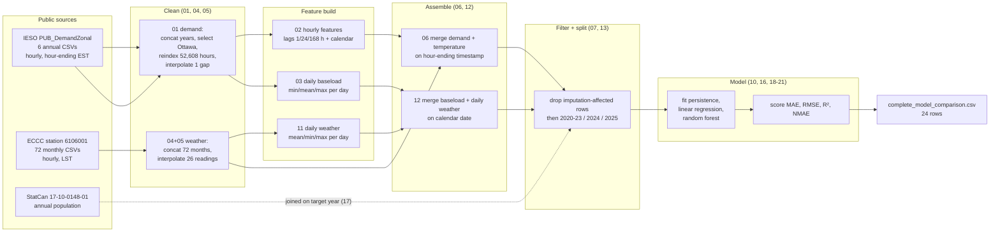
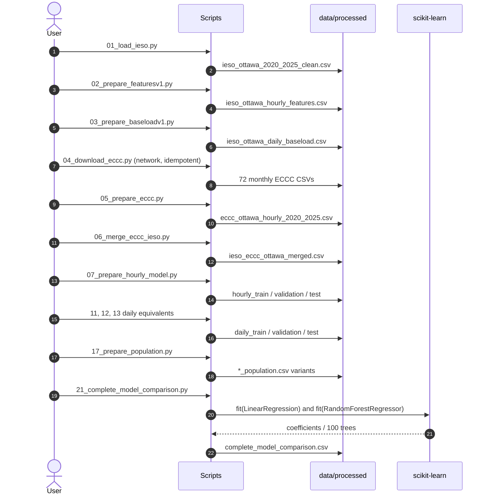
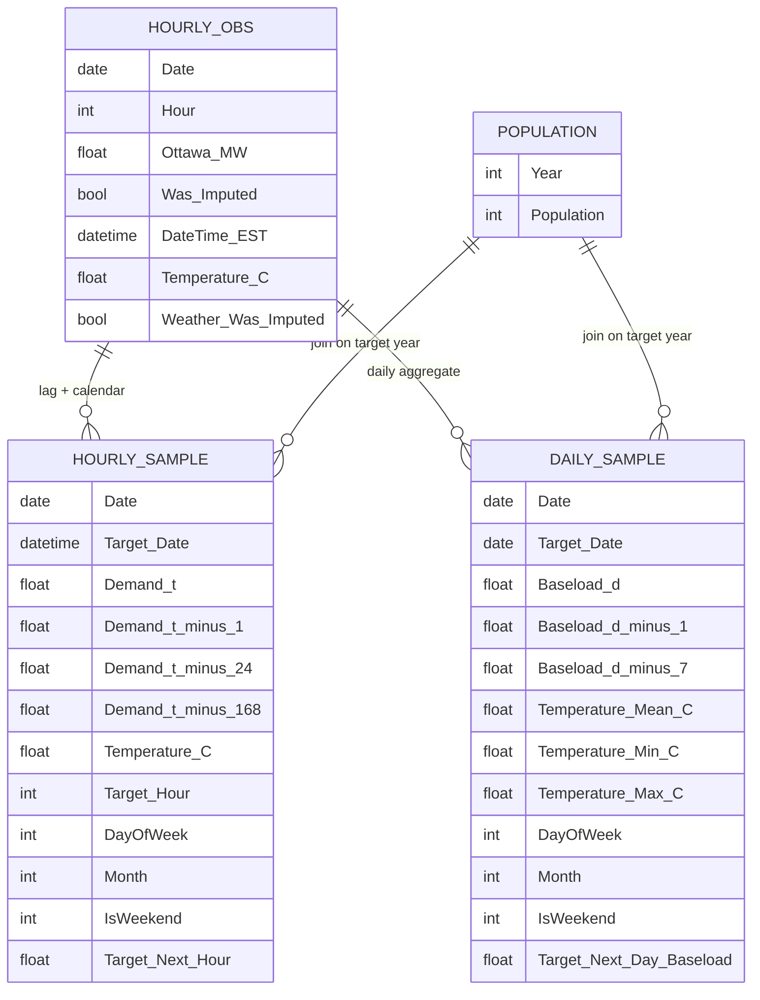
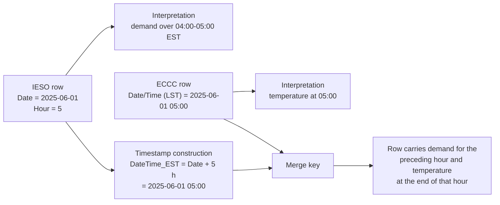
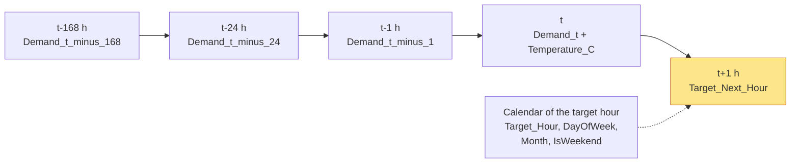
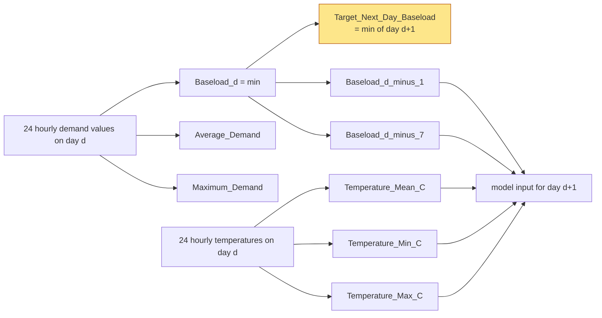
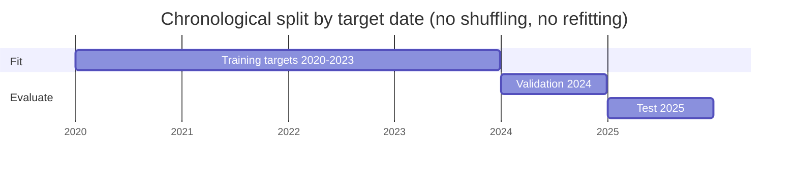
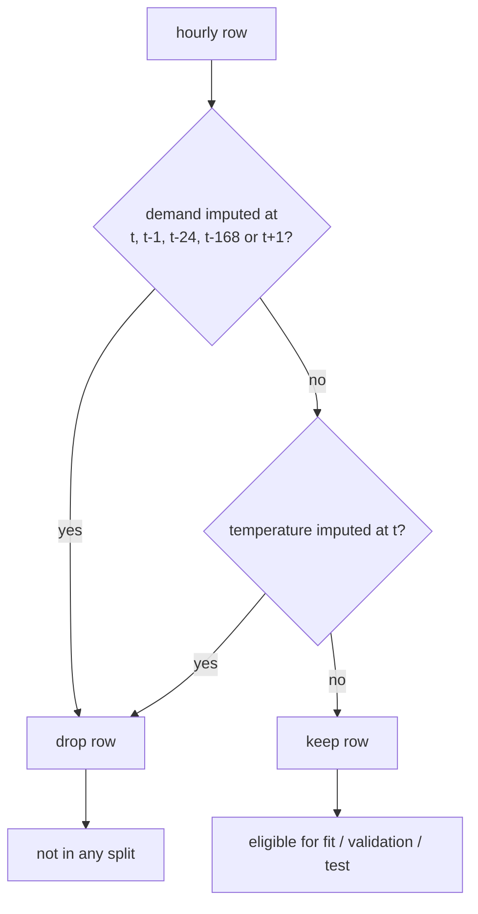

# Design — Ottawa Electricity Demand Forecasting

| Field | Value |
|---|---|
| Status | Implemented |
| Last updated | 2026-11-23 |
| Companion | [PRD.md](PRD.md) · [adr/](adr/) |

This document explains the shape of the system: how data moves from three public
sources to a 24-row comparison table, why the pipeline is partitioned the way it
is, and where the traps are. Decisions with real alternatives behind them are
recorded as ADRs and linked inline.

---

## 1. At a glance

- **Two tasks, one foundation.** Hourly demand and daily baseload are derived
  from the same cleaned hourly demand series, then modelled separately.
- **Offline batch pipeline.** 21 numbered scripts, each writing one CSV that the
  next stage reads. No database, no scheduler, no package.
- **Three estimators, two evaluation years.** Persistence / linear regression /
  random forest, fitted once on 2020–2023 and scored on 2024 and 2025.
- **Leakage control is the load-bearing design choice.** Imputation flags are
  propagated through lags and labels before rows are dropped.

## 2. Architecture



Three properties fall out of this layout:

1. **Every arrow is a file.** Any stage can be rerun in isolation, and any
   intermediate can be inspected without executing Python.
2. **The two tasks only re-converge at the split stage.** They diverge after
   cleaning because their targets live at different time resolutions.
3. **Population joins late**, at the split stage, because it is an optional
   variant that must not alter the base feature matrices (ADR-0007).

## 3. Run sequence



Scripts `08`, `09`, `10`, `14`, `15`, `16`, `18`, `19`, `20` are exploratory
stages that produce the same result files as `21` for one slice at a time. They
are kept because the project write-up references them and because they isolate a
single comparison; `21` is the canonical run.

## 4. Data model



`*_population.csv` files are the same tables with one extra column; they exist
as separate files so that a run with population cannot silently overwrite a run
without it.

## 5. Time alignment

IESO reports demand with an **hour-ending** convention in Eastern Standard Time,
while ECCC reports an **instantaneous** observation at the top of each hour in
Local Standard Time. For Ottawa these are both UTC−5, so no offset correction is
needed, but the two fields are not quite the same quantity at the boundary.



Consequences, accepted deliberately (ADR-0004):

- Demand is matched to the temperature at the **close** of the demand hour, so
  temperature leads demand by up to one hour within the pair. For a one-hour-ahead
  forecaster this is a sub-hour effect, but it should not be described as
  "temperature during the demand hour".
- IESO's fixed 24-hour EST convention means there is **no 23/25-hour DST day**.
  This was verified, not assumed: `checkingtimezone.py` and a re-count of the raw
  files both show 24 rows on every date except the single incomplete day.
- The final hour of 2025 (hour-ending 24 on 2025-12-31, i.e. 2026-01-01 00:00)
  has no matching weather row because the weather file stops at
  2025-12-31 23:00. That single row is removed by the missing-value drop, not
  interpolated.

## 6. Feature construction

### Hourly task



The three lags are the same clock hour yesterday, the same clock hour one week
ago, and the immediately preceding hour. `Demand_t` is the persistence signal
and the strongest single feature. Calendar fields are computed from
`Target_Date`, not from the current row, which matters at hour 24: the
day-of-week must describe the hour being predicted.

### Daily task



Baseload is the daily **minimum**, not the mean, because the minimum is the
closest observable proxy to the always-on component of demand and is far less
volatile than the daily peak (ADR-0005).

## 7. Evaluation protocol



The split is made on `Target_Date`, not on `Date`. This prevents the last hours
of 2023 from carrying labels that belong to 2024, which is the classic off-by-one
in time-series splitting.

Both evaluation years are scored with the **same fitted models**. Nothing is
refitted on 2024 before scoring 2025, so the 2025 result is a genuine out-of-time
test of a model that never saw either year.

| Split | Hourly rows | Daily rows |
|---|---|---|
| Fit (2020–2023) | 34,875 | 1,438 |
| Validation (2024) | 8,781 | 363 |
| Test (2025) | 8,752 | 359 |

Row counts are below the calendar maximum because of imputation exclusions:
2024 has 8,784 hours and 366 days; 2025 has 8,760 hours and 365 days.

## 8. Leakage controls



The same rule is applied daily, with lags of 1 and 7 days and the target day.
The reason for propagating to lags rather than flagging only the repaired row is
simple: a repaired value used as a *feature* is still synthetic information, and
a repaired value used as a *label* would make an error-free prediction possible
on that row. See ADR-0003.

Additional leakage guards:

| Guard | Implementation |
|---|---|
| No shuffling | `sort_values` then year filters; no `train_test_split` |
| No scaler fitted on all data | No scaling at all |
| No target encoding or global statistics | Only row-local lags and calendar fields |
| No future temperature | Current-hour observation only, never `t+1` weather |
| No refit on validation | Fit once on 2020–2023, reuse for both years |

## 9. Model layer

| Estimator | Configuration | Rationale |
|---|---|---|
| Persistence | predict `Demand_t` / `Baseload_d` | Floor that any useful model must clear |
| Linear regression | `LinearRegression()` defaults, intercept fitted | Interpretable additive baseline; exposes whether relationships are near-linear |
| Random forest | `n_estimators=100`, `max_depth=15`, `min_samples_leaf=2`, `random_state=42`, `n_jobs=-1` | Captures nonlinear temperature and hour interactions without hand-built transforms |

No feature scaling is applied. Tree ensembles are invariant to monotone feature
scaling; linear regression coefficients are therefore reported in native units
(MW per °C, MW per person) and should be read with that in mind. Hyperparameters
were fixed rather than searched, and the project does not claim otherwise
(ADR-0006).

## 10. Directory map

```
coding/
  01-06   ingestion and cleaning      → ieso_*_clean.csv, eccc_*_hourly.csv, merged
  07,13   filtering and splitting     → hourly_*, daily_* train/validation/test
  08-10   hourly experiments          → hourly_final_test_results.csv
  11-12   daily weather assembly      → eccc_*_daily.csv, daily_*_merged.csv
  14-16   daily experiments           → daily_final_test_results.csv
  17      population join             → *_population.csv
  18-20   population comparisons      → *_population_comparison.csv
  21      canonical full comparison   → complete_model_comparison.csv
  data/   raw and processed CSVs      (committed, ~45 MB)
```

## 11. Operational notes

| Concern | Position |
|---|---|
| Runtime | Minutes on a laptop CPU; dominated by eight forest fits in script 21 |
| Memory | All frames are under ~7 MB on disk; no chunking needed |
| Network | Only `04_download_eccc.py`; no API key; skips existing files |
| Determinism | Guaranteed by seeded RF, fixed row order, no sampling outside RF bootstrap |
| Environment | Python 3 with `pandas`, `numpy`, `scikit-learn`, `requests`; no lockfile in repo |
| Git hygiene | Raw and processed data are committed, which makes the repo heavy but self-contained (ADR-0008) |

## 12. Known limitations and technical debt

| Item | Kind | Note |
|---|---|---|
| Observed weather, not forecast weather | Design | Bounds the study to a retrospective evaluation |
| Population from the target year | Design, disclosed | Hindsight feature; may proxy the year trend |
| No `requirements.txt` / lockfile | Debt | Environment not reproducible bit-for-bit |
| Two near-duplicate entry points per task (`10` vs `21`) | Debt | Results agree, but duplicated feature lists invite drift |
| Feature lists repeated in 6 scripts | Debt | A single `features.py` module would remove the duplication |
| `New Python file.py` (empty) | Debt | Should be deleted |
| Windows absolute path inside the project docx | Debt | Documentation artifact only |
| No automated tests | Debt | Verification is by printed diagnostics and row-count assertions |
| Only one weather station | Scope | Station 6106001 is the only continuous Ottawa record |

## 13. Decision index

| ADR | Decision |
|---|---|
| [0001](adr/0001-two-forecasting-tasks.md) | Model two tasks: next-hour demand and next-day baseload |
| [0002](adr/0002-chronological-evaluation-split.md) | Chronological 2020-23 / 2024 / 2025 split, no refitting |
| [0003](adr/0003-exclude-imputed-observations.md) | Exclude imputed values and every row that depends on them |
| [0004](adr/0004-hour-ending-timestamp-alignment.md) | Align IESO hour-ending EST demand with ECCC LST weather |
| [0005](adr/0005-baseload-as-daily-minimum.md) | Define baseload as the daily minimum hourly demand |
| [0006](adr/0006-model-selection-and-no-hyperparameter-tuning.md) | Persistence + linear + forest, with fixed hyperparameters |
| [0007](adr/0007-annual-population-feature.md) | Add annual population as an optional, disclosed feature |
| [0008](adr/0008-file-based-numbered-script-pipeline.md) | Numbered scripts with CSV handoffs instead of a package or DAG runner |
