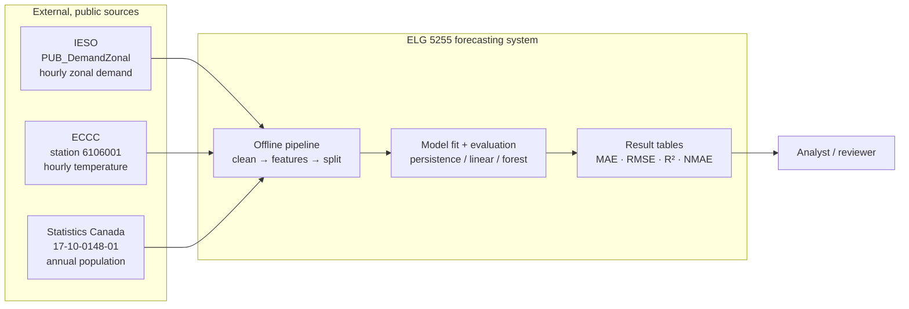

# PRD — Ottawa Electricity Demand Forecasting

| Field | Value |
|---|---|
| Status | Accepted — retrospective specification of the delivered system |
| Version | 1.0 |
| Last updated | 2026-11-23 |
| Owners | ELG 5255 group project (University of Ottawa) |
| Related | [DESIGN.md](DESIGN.md) · [adr/](adr/) |
| Deliverable | Branch `docs/prd-adr-design`, pull request into `main` |

> **Note on provenance.** This PRD was written after the models were built, to
> document the requirements the work actually satisfies. It is a specification
> of the delivered system, not a pre-registration. Where a requirement was only
> met partially, it is marked as such rather than silently dropped.

---

## 1. Problem statement

Ontario's electricity grid is operated by the Independent Electricity System
Operator (IESO), which publishes measured demand per transmission zone. Ottawa
appears as its own zone. Two forecasts are operationally interesting and both
can be attempted from public data alone:

1. **Very short-term load:** how much demand will Ottawa draw in the **next
   hour**? This is the classic one-step-ahead load forecasting problem, where
   recent history carries most of the signal.
2. **Daily baseload:** what is the **lowest** demand Ottawa will reach on the
   **next day**? The daily minimum is a stable, slowly moving quantity that is
   useful for maintenance windows, outage planning, and as a proxy for the
   "always-on" component of demand.

A forecasting model is only credible if it beats a trivial rule. The purpose of
this project is therefore not merely to fit a model, but to **quantify how much
skill** is available beyond persistence, and **which additional inputs actually
pay for themselves**.

## 2. Goals

| ID | Goal |
|---|---|
| G1 | Build both forecasts end-to-end from real, public, citable data — no synthetic or hand-entered series in the modelled pipeline |
| G2 | Beat a persistence baseline on held-out data, by a margin large enough to be meaningful rather than noise |
| G3 | Isolate the contribution of each input group: history, weather, calendar, population |
| G4 | Evaluate without temporal leakage, so results are not inflated by seeing the future |
| G5 | Keep the whole study reproducible from a clean clone on a laptop, with no GPU and no paid services |
| G6 | Report limitations honestly, including cases where a feature does not help |

## 3. Non-goals

| ID | Explicitly out of scope | Why |
|---|---|---|
| NG1 | Operational, real-time forecasting | Weather inputs are *observed* temperature, not forecasts; demand lags are observed, not guaranteed available at issue time |
| NG2 | Probabilistic / interval forecasts | Point forecasts only; no quantile or conformal layer |
| NG3 | Economic dispatch, unit commitment, price forecasting | Different problem class |
| NG4 | Deep learning (LSTM, transformer) | Sample size and scope do not justify it; linear and tree ensembles are sufficient to answer the research question |
| NG5 | Statutory holiday effects | Would need a holiday calendar; flagged as future work |
| NG6 | Household-level consumption | Data is **aggregate zonal grid demand**, not metered consumption by Ottawa households |
| NG7 | Hyperparameter optimisation | Deliberately omitted; see ADR-0006 |
| NG8 | Multi-step recursive forecasting | Evaluation is one-step-ahead with observed inputs at each step |

## 4. Users and stakeholders

| Actor | Need |
|---|---|
| Course evaluator / reviewer | Evidence of a complete, defensible ML workflow on real data |
| Future maintainer | Enough documentation to rerun, audit, or extend the pipeline |
| Analyst reading the results | Clear statement of what was predicted, how well, and under what assumptions |

## 5. Scope of the delivered system

Two forecasting tasks share one data foundation.

| Task | Target variable | Unit | Horizon | Granularity |
|---|---|---|---|---|
| **T1 — Next-hour demand** | `Target_Next_Hour` | MW | +1 hour | Hourly |
| **T2 — Next-day baseload** | `Target_Next_Day_Baseload` | MW | +1 day | Daily |

Three estimators are compared on both tasks: a **persistence baseline**, **linear
regression**, and **random forest**. Each model is evaluated twice: once on an
internal validation year (2024) and once on a held-out test year (2025).

### System context

## 6. Functional requirements

| ID | Requirement | Status |
|---|---|---|
| FR-1 | Ingest all six annual IESO zonal demand files and select the `Ottawa` zone | Met — `01_load_ieso.py` |
| FR-2 | Reconstruct a complete hourly index for 2020-01-01 … 2025-12-31 and repair missing hours by interpolation, recording which rows were repaired | Met — 1 gap repaired |
| FR-3 | Ingest the 72 monthly ECCC weather files for station 6106001 and retain temperature only | Met — `04`, `05` |
| FR-4 | Repair missing temperature readings and flag them | Met — 26 readings repaired |
| FR-5 | Join demand and temperature on a single consistent hourly timestamp | Met — `06` |
| FR-6 | Construct T1: current demand, three lags (1 h, 24 h, 168 h), current temperature, and target-hour calendar features | Met — `02` |
| FR-7 | Construct T2: daily minimum/mean/maximum demand and daily mean/min/max temperature, plus target-day calendar features | Met — `03`, `11`, `12` |
| FR-8 | Exclude every observation whose feature vector or label depends on an imputed value | Met — `07`, `13` |
| FR-9 | Split chronologically into fit / validate / test by **target date**, with no shuffling and no refitting between evaluation years | Met — `07`, `13` |
| FR-10 | Fit and evaluate persistence, linear regression, and random forest on both tasks | Met — `10`, `16`, `21` |
| FR-11 | Optionally add annual population and report the effect with and without it | Met — `17`–`21` |
| FR-12 | Emit a single machine-readable comparison table covering both tasks, both population variants, both periods, and all estimators | Met — 24 rows, `complete_model_comparison.csv` |
| FR-13 | Re-running any stage must not require re-downloading data that already exists | Met — `04` skips existing files |
| FR-14 | Holiday effects | **Not met** — out of scope (NG5) |

## 7. Data requirements

| ID | Requirement | Detail |
|---|---|---|
| D-1 | Data must be public and attributable | IESO zonal demand reports; ECCC Historical Climate Data; StatCan table 17-10-0148-01 |
| D-2 | Coverage must span at least five years to expose seasonality and one full held-out year | 2020-01-01 → 2025-12-31, 2,192 calendar days |
| D-3 | Weather must be station-local, not city-aggregated | Ottawa International Airport (Climate ID 6106001), the station whose record is continuous over the period |
| D-4 | Population must match the geography of the demand zone | Ottawa–Gatineau CMA, **Ontario part only**, excluding the Quebec portion |
| D-5 | Every repaired value must be traceable | `Was_Imputed` (demand) and `Weather_Was_Imputed` / `Imputed_Hours` (weather) are carried through to the modelling tables |
| D-6 | Units must be explicit and consistent | Demand in MW, temperature in °C, population in persons, calendar fields as integers |

### Verified dataset facts

| Quantity | Value |
|---|---|
| Raw IESO rows | 52,607 (2,192 dates; one date has 23 rows) |
| Clean hourly demand rows after reindex | 52,608 |
| Raw ECCC rows | 52,608 (24 per day, LST has no DST shift) |
| Missing temperature readings | 26 |
| Demand values interpolated | 1 (2025-05-01 hour 1 → 711.5 MW) |
| Daily aggregates | 2,192 |

## 8. Non-functional requirements

| ID | Requirement | How it is met |
|---|---|---|
| NFR-1 | **Reproducible** — identical results on rerun | `random_state=42`; deterministic sort and split; no shuffling; no sampling outside seeded RF bootstrap |
| NFR-2 | **Leakage-free** — no future information in features or labels | Chronological split by target date; imputation flags propagated through lags and target before dropping rows; targets are strictly `t+1` |
| NFR-3 | **Portable** — runs on a laptop, CPU only | pandas/NumPy/scikit-learn; largest step (`21`) fits 8 models on ≤ 35k rows |
| NFR-4 | **Inspectable** — every intermediate is a named CSV | 26 files in `coding/data/processed/`, one per pipeline stage |
| NFR-5 | **No secrets, no credentials in the repo** | Only one stage touches the network (ECCC bulk download), and it needs no key |
| NFR-6 | **Path-independent** | All paths derive from `Path(__file__).resolve().parent` |
| NFR-7 | **Idempotent ingestion** | Existing downloads are skipped; processed files are overwritten deterministically |

## 9. Success metrics and results

Metrics are computed on the held-out 2025 test year. `NMAE` is MAE divided by
the mean actual value in that period, which makes the hourly and daily tasks
comparable.

### Targets set for the study, and outcomes

| ID | Criterion | Outcome |
|---|---|---|
| S1 | Hourly RF MAE at least 25 % below persistence | **Met — 60.9 % below** (14.13 vs 36.18 MW) |
| S2 | Daily RF MAE at least 10 % below persistence | **Met — 20.1 % below** (31.69 vs 39.65 MW) |
| S3 | Hourly best R² ≥ 0.95 | **Met — 0.9903** |
| S4 | Daily best R² ≥ 0.80 | **Met — 0.8849** |
| S5 | No collapse between validation and test (best-model MAE within ±10 %) | **Met** — hourly −6.0 %, daily +7.1 % |
| S6 | Population effect quantified for both tasks | **Met** — hourly ≈ 0, daily −2.5 % MAE |
| S7 | Every metric reported without feature-scaling ambiguity | **Met** — no scaling applied; trees are scale-free, and linear coefficients are reported in native units with that caveat |

### Next-hour demand — 2025 test

| Model | MAE (MW) | RMSE (MW) | R² | NMAE |
|---|---|---|---|---|
| Persistence | 36.18 | 45.03 | 0.9447 | 3.51 % |
| Linear regression | 20.78 | 27.20 | 0.9798 | 2.01 % |
| **Random forest** | **14.13** | **18.86** | **0.9903** | **1.37 %** |

### Next-day baseload — 2025 test

| Model | MAE (MW) | RMSE (MW) | R² | NMAE |
|---|---|---|---|---|
| Persistence | 39.65 | 53.82 | 0.8160 | 4.79 % |
| Linear regression | 37.40 | 50.84 | 0.8358 | 4.52 % |
| Random forest | 32.52 | 44.08 | 0.8766 | 3.93 % |
| **Random forest + population** | **31.69** | **42.57** | **0.8849** | **3.83 %** |

## 10. Acceptance criteria

The system is accepted when all of the following hold on a clean clone:

1. Scripts `01` → `21` run in order with no manual edits, on `pandas`, `numpy`,
   `scikit-learn`, and `requests` only.
2. `coding/data/processed/complete_model_comparison.csv` is produced with
   exactly **24 rows** (2 tasks × 2 population variants × 2 periods × 3
   estimators).
3. The training matrices contain no missing values in any selected feature or
   target.
4. `hourly_train`, `hourly_validation`, `hourly_test` contain 34,875 / 8,781 /
   8,752 rows; `daily_*` contain 1,438 / 363 / 359 rows.
5. No row in a test split has a target date inside the training period.
6. Reported metrics reproduce to within floating-point tolerance.

## 11. Risks and mitigations

| Risk | Impact | Mitigation in place | Residual risk |
|---|---|---|---|
| Observed temperature used instead of a forecast | Results overstate operational skill | Explicitly labelled a retrospective evaluation (NG1) | Unquantified optimistic bias |
| Population matched by target year, including late-published estimates | Population effect is partly hindsight | Disclosed in ADR-0007 and results commentary | Effect size may shrink in true real time |
| Population acting as a proxy for the year trend | Misattributed causality | Called out; no causal claim made | Unresolved |
| 2025 inspected while choosing the population variant | Mild selection bias | Disclosed; both variants reported in full | Cannot be removed retrospectively |
| Single weather station | Under-represents Ottawa's microclimate | Station choice documented | Regional error uncaptured |
| Two evaluation years only | Limited evidence of long-run robustness | Both years reported | Regime change untested |
| Imputation interacts with lag features | Subtle leakage if mishandled | Row exclusion through lags and target (ADR-0003) | Small sample loss near the gap |

## 12. Future work

| Item | Would address |
|---|---|
| Use archived weather **forecasts** instead of observations | NG1 — makes the evaluation operational |
| Vintage population estimates as published at issue time | Population hindsight bias |
| Add statutory holidays and school terms | FR-14 |
| Add lagged temperature and heating/cooling degree hours | Nonlinear temperature response |
| Tune RF with a time-series CV scheme **inside** the training window | ADR-0006 limitation |
| Recursive multi-step evaluation | Honest day-ahead operational setting |
| Quantile regression or conformal intervals | NG2 |
| Per-zone models for neighbouring IESO zones | Spatial structure |

## Appendix A — Data dictionary (modelled tables)

### Hourly sample (`hourly_*.csv`)

| Column | Type | Meaning |
|---|---|---|
| `Date` | date | Date of the observation hour (IESO convention) |
| `Target_Date` | date | Calendar date of the hour being predicted |
| `DateTime_EST` | datetime | Hour-ending timestamp, `Date + Hour` hours |
| `Demand_t` | MW | Demand in the current hour |
| `Demand_t_minus_1` | MW | Demand one hour earlier |
| `Demand_t_minus_24` | MW | Demand 24 hours earlier |
| `Demand_t_minus_168` | MW | Demand 168 hours (one week) earlier |
| `Temperature_C` | °C | Observed temperature at the current hour |
| `Target_Hour` | 1–24 | Hour being predicted |
| `DayOfWeek` | 0–6 | Weekday of the target hour, Monday = 0 |
| `Month` | 1–12 | Month of the target hour |
| `IsWeekend` | 0/1 | Target hour falls on Saturday or Sunday |
| `Target_Next_Hour` | MW | **Label** — demand in the following hour |

### Daily sample (`daily_*.csv`)

| Column | Type | Meaning |
|---|---|---|
| `Date` | date | Day the features describe |
| `Target_Date` | date | Day being predicted (`Date + 1`) |
| `Baseload_d` | MW | Minimum hourly demand on `Date` |
| `Baseload_d_minus_1` | MW | Minimum on the previous day |
| `Baseload_d_minus_7` | MW | Minimum seven days earlier |
| `Temperature_Mean_C` | °C | Mean temperature on `Date` |
| `Temperature_Min_C` | °C | Minimum temperature on `Date` |
| `Temperature_Max_C` | °C | Maximum temperature on `Date` |
| `DayOfWeek` / `Month` / `IsWeekend` | int | Calendar attributes of `Target_Date` |
| `Hourly_Observations` | count | Hours available that day (quality flag) |
| `Imputed_Hours` | count | Hours interpolated that day (quality flag) |
| `Target_Next_Day_Baseload` | MW | **Label** — minimum hourly demand on `Target_Date` |

### Population (`ottawa_ontario_population_2020_2025.csv`)

| Column | Type | Meaning |
|---|---|---|
| `Year` | int | 2020–2025 |
| `Population` | persons | July 1 estimate, Ottawa–Gatineau CMA, Ontario part |
