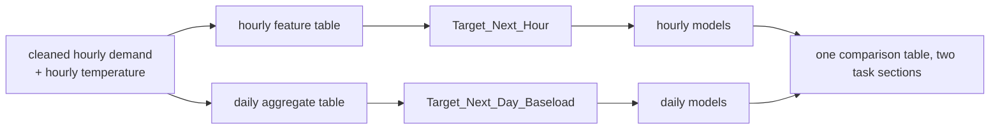

# ADR-0001 — Model two separate forecasting tasks

| Field | Value |
|---|---|
| Status | Accepted |
| Date | 2026-11-23 (records a decision made during the project) |
| Deciders | Project team |
| Related | [PRD §5](../PRD.md), [DESIGN §1](../DESIGN.md) |

## Context

The IESO zonal demand file is an hourly series. A single hourly model is the
obvious default, but the project brief asked for a forecasting study, and an
hourly point forecast is only one of several quantities a grid analyst cares
about. Two candidates were on the table:

- **Next-hour demand** — the standard one-step-ahead load forecasting problem.
  Recent history dominates, errors are small in relative terms, and the result
  is easy to explain.
- **Next-day baseload** — the minimum hourly demand of the following day. It is
  a different quantity (a daily statistic of a daily statistic), it moves slowly,
  and it is more sensitive to weather and trend than to the previous hour.

Collapsing both into one model was rejected early: the targets have different
horizons, different aggregation levels, and different error scales. A single
model would have to pick one target, and any comparison between the two would
become meaningless.

## Decision

Build **two independent forecasting tasks** on one shared cleaned dataset:

| Task | Target | Horizon | Resolution |
|---|---|---|---|
| Hourly | `Target_Next_Hour` | +1 hour | 52,608 hourly rows |
| Daily | `Target_Next_Day_Baseload` | +1 day | 2,192 daily rows |

Each task gets its own feature set, its own train/validation/test files, and its
own results table. They share only the cleaned hourly demand series and the
cleaned hourly temperature series.

## Consequences

**Positive**

- Each task can be evaluated on the metric that suits it; `NMAE` makes the two
  comparable without pretending the errors are the same quantity.
- The daily task exposes behaviour the hourly task hides: daily baseload is
  harder in relative terms (3.83 % vs 1.37 % NMAE), and population helps it while
  being useless hourly.
- A failure in one task does not invalidate the other.

**Negative**

- Two feature pipelines, two split scripts, two experiment scripts — roughly
  double the code and the surface for feature-list drift.
- Results must be read per task; there is no single headline number.

## Alternatives considered

| Alternative | Why rejected |
|---|---|
| Hourly model only | Discards the daily-baseload question the project set out to answer |
| Daily mean demand instead of baseload | Mean is dominated by the evening peak and duplicates the hourly task's information |
| Single multi-output model | Different horizons and resolutions; no shared label space |
| Forecast both but report one blended score | Hides the fact that the two tasks have very different achievable accuracy |

## References

- [DESIGN §6 — Feature construction](../DESIGN.md)
- [ADR-0005 — Baseload as the daily minimum](0005-baseload-as-daily-minimum.md)
