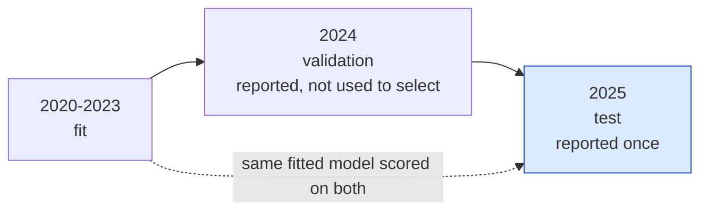

# ADR-0002 — Chronological split with no refitting between evaluation years

| Field | Value |
|---|---|
| Status | Accepted |
| Date | 2026-11-23 (records a decision made during the project) |
| Deciders | Project team |
| Related | [PRD NFR-2, S5](../PRD.md), [DESIGN §7](../DESIGN.md) |

## Context

The default scikit-learn workflow — `train_test_split` or `cross_val_score` with
shuffling — is invalid here. Electricity demand is autocorrelated at lags of one
hour, one day, and one week, and the feature set contains exactly those lags. A
random split puts the hour before a test row in the training set, so the model
can reconstruct the label almost perfectly from `Demand_t` alone. The resulting
R² would be an artifact of the split, not skill.

Data covers 2020-01-01 → 2025-12-31. The modelling code needed a protocol that
holds out whole years, keeps the test year untouched during model selection, and
is simple enough to explain without cross-validation machinery.

## Decision

Split **chronologically by target date**, once:

| Split | Target dates | Hourly rows | Daily rows |
|---|---|---|---|
| Fit | 2020-01-01 → 2023-12-31 | 34,875 | 1,438 |
| Validation | 2024 | 8,781 | 363 |
| Test | 2025 | 8,752 | 359 |

Two additional rules make the protocol meaningful:

1. **Split on `Target_Date`, not `Date`.** The last observation of 2023 predicts
   an hour in 2024; splitting on `Date` would leak one label into the fit set.
2. **Fit once, score twice.** The models fitted on 2020–2023 are reused for 2024
   and 2025. Nothing is refitted on 2024 before scoring 2025.

## Consequences

**Positive**

- No lag can reach across the split boundary, because the boundary is a wall in
  time, not a random partition.
- The 2025 score is a genuine out-of-time test: the model has seen neither 2024
  nor 2025.
- Stability between the two evaluation years is observable, which is how the
  "no collapse" criterion (PRD S5) is checked.

**Negative**

- Hyperparameters cannot be tuned honestly on the validation year while still
  claiming it as an unbiased check, so tuning was skipped rather than fudged
  (ADR-0006).
- One split means no variance estimate; a different choice of year boundary
  could change the numbers. This is disclosed rather than averaged away.
- The fit period (2020–2023) includes the pandemic, whose demand patterns differ
  from 2024–2025. That is a real distribution shift, kept deliberately because
  removing it would be hindsight.

## Alternatives considered

| Alternative | Why rejected |
|---|---|
| Random `train_test_split` | Leaks adjacent hours through the lag features; inflates R² dramatically |
| `TimeSeriesSplit` cross-validation | Correct, but 5 folds × 8 model configurations makes the narrative harder and the selection process opaque; a held-out year answers the actual question |
| Fit on 2020–2024, test on 2025 | Wastes the 2024 validation year, leaving no independent check before the test |
| Rolling-origin evaluation | Stronger, but requires recursive forecasting and a much larger experiment matrix than the project scope allows |
| Refit on 2024 for the 2025 test | Would use test-adjacent data to improve the test score and blur what is being measured |

## References

- [ADR-0003 — Exclusion of imputed observations](0003-exclude-imputed-observations.md)
- [ADR-0006 — Model selection without hyperparameter tuning](0006-model-selection-and-no-hyperparameter-tuning.md)
