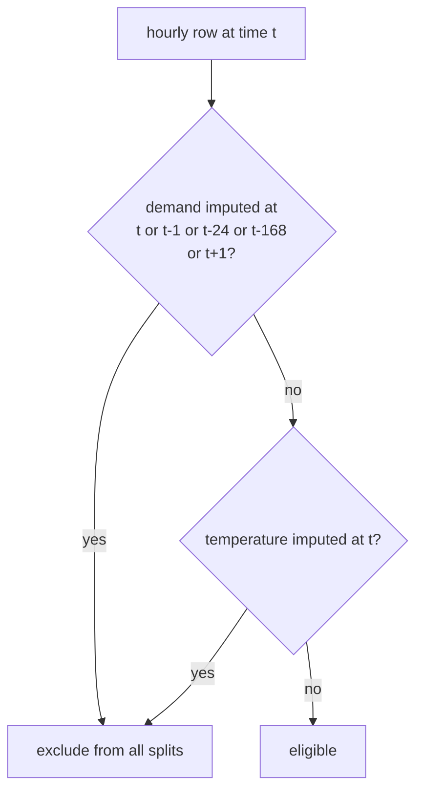

# ADR-0003 — Exclude imputed observations and everything that depends on them

| Field | Value |
|---|---|
| Status | Accepted |
| Date | 2026-11-23 (records a decision made during the project) |
| Deciders | Project team |
| Related | [PRD NFR-2](../PRD.md), [DESIGN §8](../DESIGN.md) |

## Context

Two small repairs were unavoidable:

- **Demand:** the raw IESO file has 52,607 rows for 2,192 dates. Exactly one
  hour is missing — 2025-05-01 hour 1 — so the series is reindexed onto a
  complete 24-hour grid and that value is linearly interpolated to **711.5 MW**
  (the mean of 734 at 2025-04-30 h24 and 689 at 2025-05-01 h2).
- **Weather:** 26 hourly temperature readings are blank in the raw ECCC files
  and were filled by linear interpolation, with a `Was_Imputed` flag.

Both repairs are defensible for a *continuous* series, but they create a subtle
problem for *supervised learning*. A repaired value does not sit still: it
becomes a feature via `Demand_t`, again via each lag, and again as the label of
the preceding row. If a repaired observation is used as the label, the model can
learn to reproduce an interpolated number to near machine precision — the
interpolation is deterministic from its neighbours, which are also inputs.

The naive options were: keep everything (contaminates the target), drop only the
repaired row (leaves it in three feature columns), or drop the dependency
closure.

## Decision

Compute a **dependency closure** and drop every row that touches a repaired
value in any role.

- Hourly closure: `t`, `t-1`, `t-24`, `t-168`, and the label at `t+1`.
- Daily closure: `d`, `d-1`, `d-7`, and the label at `d+1`; a day with any
  interpolated weather hour is excluded entirely (`Imputed_Hours > 0`).
- The flags (`Was_Imputed`, `Weather_Was_Imputed`, `Imputed_Hours`) are carried
  into every intermediate file so the closure can be recomputed at any stage.

The cost is small: 8 hourly rows out of 8,760 in 2025, 3 out of 8,784 in 2024,
and 6 daily rows out of 365.

## Consequences

**Positive**

- No synthetic value appears in any feature vector or label used for fitting or
  scoring, in either task.
- The rule is mechanical and auditable: given the flags, the exclusion set is
  reproducible without rerunning the models.
- It also removes the unmatched final hour of 2025 automatically, since the
  weather join produces `NaN` there.

**Negative**

- Slightly fewer observations, and the excluded rows are not random — they
  cluster at one timestamp and one day (2025-05-01). Negligible here, but the
  approach would be costly with frequent outages.
- Weather interpolation is computed on the full series before exclusion, so a
  repaired temperature used only as a *neighbour* still influenced the cleaned
  file; this is acceptable because it never enters a model row.
- The daily rule is conservative: one bad weather hour eliminates a whole day.

## Alternatives considered

| Alternative | Why rejected |
|---|---|
| Keep all rows | Deterministic interpolation of the label is trivially learnable; inflates scores |
| Drop only the repaired row | Repaired value remains in `Demand_t_minus_*`, so the closure is incomplete |
| Forward-fill instead of interpolate | Still synthetic, and introduces a bias that looks like a real plateau |
| Model missingness as a feature | Would require enough missing rows to learn from; here there is one |
| Impute with a separate predictive model | Overkill for 27 values and adds its own leakage surface |

## References

- [DESIGN §8 — Leakage controls](../DESIGN.md)
- [ADR-0004 — Timestamp alignment](0004-hour-ending-timestamp-alignment.md)
