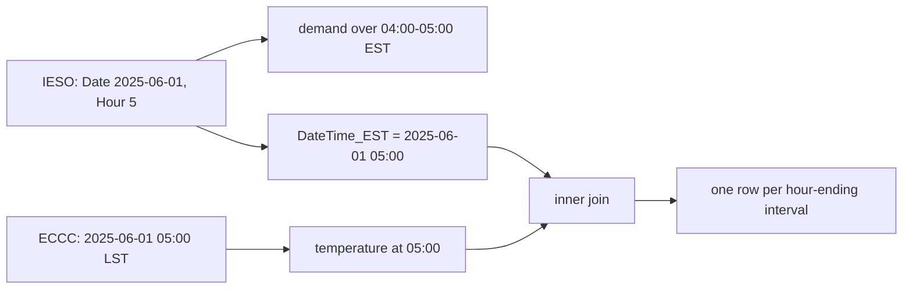

# ADR-0004 — Align IESO hour-ending EST demand with ECCC LST weather

| Field | Value |
|---|---|
| Status | Accepted |
| Date | 2026-11-23 (records a decision made during the project) |
| Deciders | Project team |
| Related | [DESIGN §5](../DESIGN.md), [`coding/checkingtimezone.py`](../../coding/checkingtimezone.py) |

## Context

The two time series use different conventions, and getting this wrong silently
misaligns every row by an hour or drops a day per year.

- **IESO `PUB_DemandZonal`** labels each row `Date` + `Hour`, where `Hour` runs
  1–24 and the value is demand **at the end of** that hour, i.e. hour-ending.
  Critically, the report is in **Eastern Standard Time year-round**: there is no
  spring-forward or fall-back row.
- **ECCC hourly climate data** labels each row `Date/Time (LST)` with a
  timestamp at the **top** of the hour, in Local Standard Time. Again no DST
  shift.

For Ottawa, LST = EST = UTC−5, so no offset is required. But "hour-ending 05:00"
and "observation at 05:00" are not the same instant conceptually, and the
obvious join (`Date` + `Hour` on the ECCC timestamp) had to be checked rather
than assumed.

## Decision

Construct an explicit hour-ending timestamp and join on it:

```python
ieso["DateTime_EST"] = ieso["Date"] + pd.to_timedelta(ieso["Hour"], unit="h")
merged = ieso.merge(weather, left_on="DateTime_EST", right_on="DateTime_LST",
                    how="left", validate="one_to_one")
```

The join is declared `validate="one_to_one"` so that duplicate or unexpected
timestamps fail loudly instead of fanning out rows.



DST was verified, not trusted: a re-count of the six raw IESO files shows 24
rows on every date, including 2020-03-08 and 2020-11-01, with exactly one
incomplete date (2025-05-01, 23 rows). `checkingtimezone.py` exists as the
scratch script that established this.

## Consequences

**Positive**

- Exactly 52,608 hourly rows after reindex, no duplicated hours, no phantom DST
  day.
- The merge is explicit and self-documenting; a future reader does not have to
  guess the convention.
- Failure is loud: `one_to_one` raises if either side breaks the contract.

**Negative**

- The matched temperature is the value at the **end** of the demand interval, so
  it leads the hour's average temperature by up to an hour. With a one-hour
  horizon this is a sub-hour effect, but the pair should not be described as
  "temperature during the demand hour".
- The final hour of the period (hour-ending 24 on 2025-12-31 = 2026-01-01 00:00)
  has no weather partner and becomes `NaN`; it is dropped downstream rather than
  extrapolated.
- If the project were extended to a zone in a different time zone, the fixed
  offset assumption would need revisiting.

## Alternatives considered

| Alternative | Why rejected |
|---|---|
| Join on `Date` + `Hour` directly without constructing a timestamp | Implicitly assumes hour-beginning; misaligns by one hour and hides the assumption |
| Treat `Hour` as hour-beginning | Would match the *previous* hour's temperature to each demand value |
| Shift weather by −1 hour to approximate mid-hour temperature | Ad hoc; would need its own justification and would worsen the label boundary |
| Convert both series to a local-time zone with DST | Both sources are already standard time; applying DST would invent hours that do not exist in the data |
| Inner join | Same effective result here, but silently drops rows instead of surfacing them as `NaN` for inspection |

## References

- [DESIGN §5 — Time alignment](../DESIGN.md)
- [ADR-0003 — Exclusion of imputed observations](0003-exclude-imputed-observations.md)
