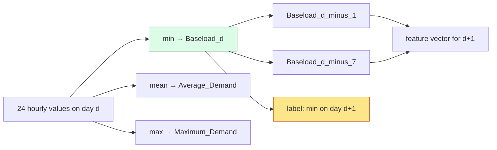

# ADR-0005 — Define baseload as the daily minimum hourly demand

| Field | Value |
|---|---|
| Status | Accepted |
| Date | 2026-11-23 (records a decision made during the project) |
| Deciders | Project team |
| Related | [PRD §5](../PRD.md), [DESIGN §6](../DESIGN.md) |

## Context

The daily task needs a single number per day. Hourly demand within a day has a
strong, weather-sensitive shape: a night trough, a morning ramp, an evening
peak. Three daily summaries were natural candidates:

| Candidate | Behaviour |
|---|---|
| Daily **mean** | Smooth, but dominated by the peak hours and heavily weather-driven |
| Daily **maximum** | The most volatile summary; largely a restatement of the evening peak |
| Daily **minimum** | The most stable summary; close to the always-on component of demand |

The project question was specifically about *baseload* — the demand floor that
persists regardless of time of day. Using the mean and calling it baseload would
have been a naming convenience rather than a modelling choice.

## Decision

Define the daily target as the **minimum of the 24 hourly demand values**:

```
Baseload_d                = min(Ottawa within day d)
Target_Next_Day_Baseload  = Baseload_{d+1}
```

The daily table also keeps `Average_Demand` and `Maximum_Demand` as columns, so
the alternate summaries remain available for inspection without changing the
target. Features are the current and lagged minima (`d`, `d-1`, `d-7`) plus
daily temperature statistics.



## Consequences

**Positive**

- The label matches the plain-language meaning of baseload, so interpretation
  does not rely on a metaphor.
- The minimum is much less volatile than the peak, which is why persistence is a
  credible baseline on this task (R² 0.816) rather than a straw man.
- Keeping mean and max in the table allows a future study to switch targets with
  a one-line change.

**Negative**

- The minimum is sensitive to a single unusual hour (for example a transient
  outage or an unseasonal mild night), so the series has occasional sharp
  excursions rather than being purely smooth.
- It is a *derived* quantity: it answers "how low will demand go tomorrow",
  which is useful for maintenance planning but is not what an operator schedules
  generation against.
- One imputed weather hour removes the whole day under ADR-0003, which is
  proportionally more costly at daily resolution than at hourly.

## Alternatives considered

| Alternative | Why rejected |
|---|---|
| Daily mean demand | Measures average load, not the floor; duplicates what the hourly task already captures |
| Daily peak demand | Highly weather-sensitive and dominated by one evening hour; harder to justify as "baseload" |
| Night-window minimum (e.g. 00:00–05:00) | More operational, but introduces an arbitrary window and discards genuinely low daytime values |
| Percentile (e.g. 5th) of hourly demand | More robust to outliers, but no longer interpretable as an observed demand level |
| Forecast all 24 hours and take the minimum | Recursive multi-step forecasting, out of scope (PRD NG8) |

## References

- [ADR-0001 — Two forecasting tasks](0001-two-forecasting-tasks.md)
- [`coding/03_prepare_baseloadv1.py`](../../coding/03_prepare_baseloadv1.py)
