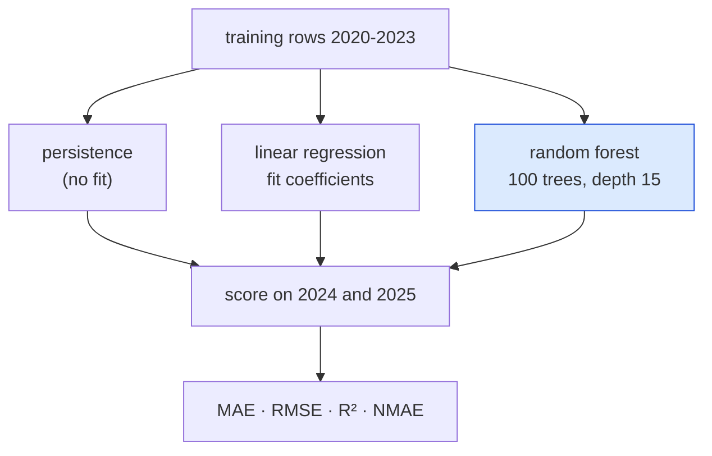

# ADR-0006 — Three estimators, fixed hyperparameters, no search

| Field | Value |
|---|---|
| Status | Accepted |
| Date | 2026-11-23 (records a decision made during the project) |
| Deciders | Project team |
| Related | [PRD S1-S3, NG7](../PRD.md), [DESIGN §9](../DESIGN.md) |

## Context

The study needed a comparison that supports a claim like "machine learning adds
value over a trivial rule". That requires, at minimum:

1. A **floor** — a rule with no learning, so improvement has a reference point.
2. A **transparent model** — so the direction and size of each input's effect is
   visible.
3. A **flexible model** — capable of representing interactions (temperature ×
   hour, weekday × season) that an additive model cannot.

With roughly 35k hourly training rows and 1.4k daily rows, deep learning is not
justified, and a large model zoo would obscure the comparison rather than
strengthen it. Hyperparameter tuning also creates a protocol problem: tuning on
the 2024 validation year and then reporting 2024 as validation would make that
year do double duty.

## Decision

Compare exactly three estimators on both tasks:

| Estimator | Settings | Role |
|---|---|---|
| Persistence | predict `Demand_t` / `Baseload_d` | Floor, zero parameters |
| Linear regression | `LinearRegression()` defaults | Interpretable additive model |
| Random forest | `n_estimators=100, max_depth=15, min_samples_leaf=2, random_state=42, n_jobs=-1` | Nonlinear interactions |

Hyperparameters are **fixed a priori and not optimised**. No `GridSearchCV`,
no `RandomizedSearchCV`, no scaling pipeline. The validation year is used only
to report results, and the same fitted models are scored on 2025.

## Consequences

**Positive**

- The comparison answers the actual question: does a nonlinear learner beat a
  linear one on this data, and by how much? Yes, consistently, on both tasks and
  both years.
- Coefficients from linear regression and importances from the forest provide
  two independent views of what matters, which became a substantive finding
  (lagged demand dominates; temperature matters more at daily resolution).
- No tuning means no validation-set contamination, so 2024 is an honest check.
- Runtime stays in minutes on a CPU; the whole study is rerunnable casually.

**Negative**

- The forest is probably not at its best. A tuned depth or leaf size could
  plausibly reduce MAE further, so the reported numbers are a lower bound on
  what this model class can do — they understate achievable accuracy, which is
  the safe direction for a claim but limits the result.
- `max_depth=15` on ~35k rows is a reasonable but arbitrary choice, not an
  evidenced one.
- No scaling means linear coefficients are in native units and are not directly
  comparable in magnitude across features.
- Fixed hyperparameters make the study's headline numbers sensitive to a choice
  that was never stress-tested.

## Alternatives considered

| Alternative | Why rejected |
|---|---|
| Gradient boosting (XGBoost / LightGBM) | Would likely win, but adds a dependency and a second tuning axis; the comparison is about model class, not leaderboard position |
| Ridge / Lasso | Useful for coefficient stability, but the feature count is small and collinearity is structural (lags of the same series), not accidental |
| ARIMA / SARIMAX | Classical and appropriate, but requires stationarity handling and offers no straightforward way to inject temperature and calendar features at this scale |
| Tuned RF via `GridSearchCV` on 2024 | Would invalidate 2024 as an independent check unless a third year existed |
| Nested CV or rolling-origin tuning | Correct but incompatible with the single-split protocol in ADR-0002 and beyond project scope |

## References

- [ADR-0002 — Chronological split](0002-chronological-evaluation-split.md)
- [`coding/21_complete_model_comparison.py`](../../coding/21_complete_model_comparison.py)
