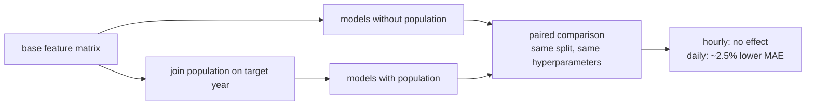

# ADR-0007 — Add annual population as an optional, disclosed feature

| Field | Value |
|---|---|
| Status | Accepted, with a known hindsight caveat |
| Date | 2026-11-23 (records a decision made during the project) |
| Deciders | Project team |
| Related | [PRD §7, §11](../PRD.md), [DESIGN §4](../DESIGN.md) |

## Context

Demand in a zone grows with the number of people drawing from it. The project
already had a rich set of short-horizon signals (lags, temperature, calendar),
but nothing representing structural growth over the six-year window. Statistics
Canada's table 17-10-0148-01 provides annual population estimates for the
Ottawa–Gatineau CMA, with an Ontario-only series that matches the geography of
the IESO Ottawa zone.

Two things made this non-obvious:

- The feature is **annual** while the targets are hourly and daily. Within a
  year it is constant, so it can only ever explain between-year variation.
- Population estimates are revised and published with a lag. Merging the
  estimate for the **target year** means the model sees a number that a real
  forecaster would not have had at issue time.

## Decision

Add `Population` as an **optional** feature, joined on the year of the target
date, and report results both **with and without** it.

```python
df["Year"] = pd.to_datetime(df["Target_Date"]).dt.year
merged = df.merge(population[["Year", "Population"]], on="Year", how="left",
                  validate="many_to_one")
```

| Year | Population (Ontario part of Ottawa–Gatineau CMA) |
|---|---|
| 2020 | 1,172,078 |
| 2021 | 1,184,369 |
| 2022 | 1,209,897 |
| 2023 | 1,246,173 |
| 2024 | 1,291,272 |
| 2025 | 1,325,788 |

The variant is implemented as a separate file set (`*_population.csv`) rather
than a column flag, so a run with population cannot overwrite a run without it.



## Consequences

**Positive**

- The comparison is clean: same rows, same splits, same settings, one added
  column. Any difference is attributable to population.
- The finding is informative rather than uniformly positive — population is
  useless hourly (±0.1 %) but consistently helps daily baseload (−3.0 % in 2024,
  −2.5 % in 2025). A feature that only helps one task is a real result.
- The caveat is documented in the PRD, the design, and the results discussion,
  so the feature cannot be cited later as if it were available in real time.

**Negative**

- **Hindsight bias.** Using the 2025 estimate to predict 2025 is not a valid
  operational setup.
- **Proxy risk.** Because population rises monotonically, it may be standing in
  for "year" and absorbing a trend the model would otherwise have to infer from
  the lags. The observed daily improvement could be trend capture rather than a
  demographic effect.
- **Selection concern.** The 2025 test was inspected while comparing the two
  variants, so the choice to keep population cannot be presented as fully
  pre-registered.
- **No within-year resolution**, so it cannot help the hourly task by
  construction.

## Alternatives considered

| Alternative | Why rejected |
|---|---|
| Omit population entirely | Would leave the growth question unexamined and ignore an available public dataset |
| Interpolate population to daily | Invents within-year variation that the source does not support |
| Use population as a *ratio* or per-capita demand | Requires a demand-per-person concept that zonal demand does not support; adds assumptions without evidence |
| Use a time index (year number) instead | Equivalent in spirit and even more obviously a trend proxy; population is at least a measured quantity |
| Vintage population (as published at issue time) | Correct for an operational system, but not readily available for every year in the window; recorded as future work |
| Model population effect only on the daily task | Would hide the hourly null result, which is itself informative |

## References

- [PRD §12 — Future work](../PRD.md)
- [`coding/17_prepare_population.py`](../../coding/17_prepare_population.py)
- [`coding/data/Statcan_Population/1710014801-eng.csv`](../../coding/data/Statcan_Population/1710014801-eng.csv)
