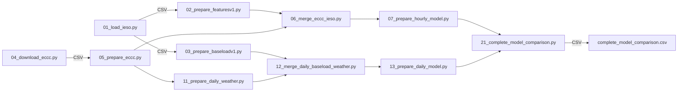

# ADR-0008 — Numbered scripts with CSV handoffs

| Field | Value |
|---|---|
| Status | Accepted |
| Date | 2026-11-23 (records a decision made during the project) |
| Deciders | Project team |
| Related | [DESIGN §2, §10](../DESIGN.md), [PRD NFR-4](../PRD.md) |

## Context

The study is a linear sequence of transformations: clean demand, clean weather,
build features, join, split, fit, score. It had to be delivered as coursework —
read and rerun by an evaluator on an unfamiliar machine, with no container, no
package install step, and no build system.

The realistic options were:

1. A package with modules and a CLI entry point.
2. A workflow DAG (Snakemake, Prefect, Airflow).
3. A notebook per stage.
4. Numbered standalone scripts, each reading and writing a named CSV.

## Decision

Use **numbered scripts in `coding/`, prefixed `01_` … `21_`, each writing one
CSV into `coding/data/processed/`**, with all paths derived from
`Path(__file__).resolve().parent`.

Conventions that make the layout work:

- A script's neighbours in the numbering are its dependencies; the prefix is the
  run order, not a ranking.
- Every intermediate is inspectable in Excel or pandas without running Python.
- Diagnostics are printed, not logged: row counts, missing-value counts, date
  ranges, and sample rows, so a failed run explains itself.
- Exploratory scripts (`08`–`10`, `14`–`16`, `18`–`20`) are kept rather than
  deleted, because the project write-up cites them and because each isolates a
  single comparison.

## Consequences

**Positive**

- Zero setup beyond four imports; `python 05_prepare_eccc.py` is the whole
  interface.
- Failures are local and repeatable: rerun one stage, not a DAG.
- A reader can follow the study top-to-bottom and see intermediate data at every
  step, which is exactly what a project report needs.
- Path handling is portable across macOS, Linux, and Windows.

**Negative**

- **Duplication.** The hourly feature list appears in five files and the daily
  list in six. If one changes, the others silently diverge — a real risk that
  already exists in the repo.
- **No dependency tracking.** Deleting a CSV does not cause dependents to
  rebuild or fail clearly; they fail at read time or, worse, run on stale data.
- **No packaging.** Nothing is importable; there is no test harness that can unit
  test a transform without running a script.
- **Script numbering is documentation.** It is not enforced, so `11`–`13` (daily
  path) sit after `07`–`10` (hourly path) and interleave the two branches in a
  way that requires the diagram above to follow.
- Committing all processed CSVs makes the repo ~45 MB and duplicates derivable
  state.

## Alternatives considered

| Alternative | Why rejected |
|---|---|
| Python package with modules + CLI | Better engineering, but adds an install step and indirection that obscures the narrative for an evaluator |
| Snakemake / Prefect | Solves rebuilds and staleness, but requires an extra toolchain and a config language for a 21-step linear pipeline |
| Jupyter notebooks | Excellent for exploration, poor for diffing and for rerunning headlessly; the project needed a reportable code listing |
| One monolithic script | No intermediate inspection, no partial rerun, and a 21-stage failure becomes a single opaque traceback |
| Commit only code, regenerate data | Smaller repo, but the evaluator may be offline and the ECCC download is rate-limited |

## References

- [`coding/01_load_ieso.py`](../../coding/01_load_ieso.py)
- [`coding/21_complete_model_comparison.py`](../../coding/21_complete_model_comparison.py)
